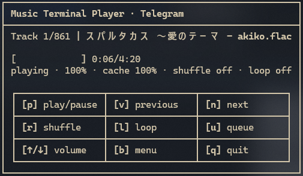
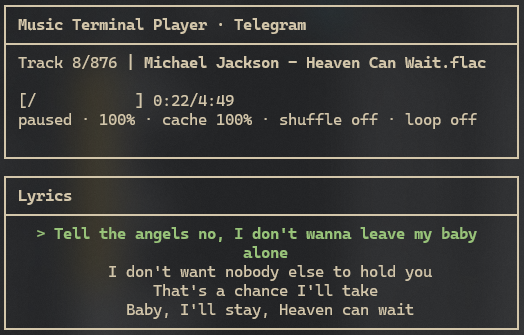
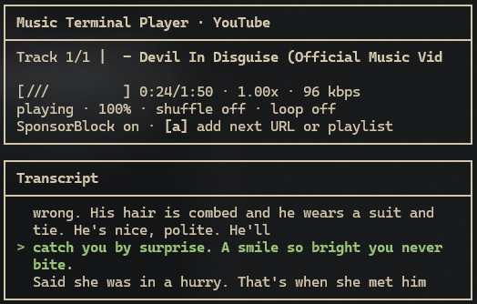

# Music Terminal Player

Lightweight, keyboard-driven terminal music player for Windows. Play local audio, stream synchronized Telegram public or private channels, manage playlists and queues, display embedded synchronized lyrics, or stream YouTube audio with synchronized transcripts through yt-dlp and FFmpeg.




## Why?

A small terminal player for local libraries and online sources without the overhead of a desktop music app. It keeps playback, queues, playlists, Telegram channels, and YouTube audio in one keyboard-driven interface. Inspired by [lowfi](https://github.com/talwat/lowfi).

## Features

- Local file and folder playback
- Telegram public- and private-channel synchronization, streaming, and offline download
- Combined multi-channel Telegram queues
- YouTube video and playlist audio streaming without saving complete media files
- YouTube persistent per-category SponsorBlock auto-skip settings
- YouTube chapter navigation: press `c` to view chapters and seek to their start times
- Optional YouTube authentication with Thorium, Google Chrome, Vivaldi, Zen Browser, or a cookies.txt file
- Synchronized YouTube transcripts
- Editable queues, playlists, shuffle, loop modes, and persistent volume
- Configurable embedded lyrics for local and Telegram tracks, including line-synchronized LRC and word-synchronized Enhanced LRC
- Optional Spicy Lyrics synchronized lyrics for local and Telegram tracks (requires approved client API access)

### Lyrics support for local files and telegram

Local and Telegram tracks can display embedded plain lyrics, synchronized LRC, and word-synchronized Enhanced LRC directly beside or below the player.

In **Lyrics settings**, choose **Lyrics source**: **Embedded only** (default, offline), **Auto** (prefer synchronized embedded lyrics), or **Spicy Lyrics preferred**. To use online lyrics, enter an approved publishable key through **Settings → Lyrics Settings → SpicyLyrics API Key** (or use the existing `SPICY_LYRICS_PUBLISHABLE_KEY` environment variable). The app shows available provider and contributor credits alongside online lyrics; it does not export them. See the [usage guide](docs/usage.md) for setup, local key storage, and API requirements.



### YouTube synchronized transcripts

YouTube playback can display available manual subtitles or automatic captions as a synchronized transcript beside or below the player.

Press `c` during YouTube playback to open **YouTube Chapters**. Navigate with `Up`/`Down` or `Page Up`/`Page Down`, press `Enter` to seek to the selected chapter, and press `Esc` to close the menu. The `♪` marker identifies the chapter currently playing. Chapter metadata loads in the background when needed; videos without chapter metadata show **No chapters available**. See the [YouTube tutorial](docs/youtube-tutorial.md) for details.



## Installing
Windows is supported. macOS and Linux support are planned.

Windows binaries are available in the [releases](https://github.com/harrytien107/Music_Terminal_Player/releases/tag/v3.1.0)

## Tutorials

Don't know how to use? Start with the guide for the source you want to play:

- [Local music tutorial](docs/local-tutorial.md) — add a music folder, play saved folders, and use playback controls.
- [Telegram tutorial](docs/telegram-tutorial.md) — create API credentials, log in, synchronize channels, and stream or download music.
- [YouTube tutorial](docs/youtube-tutorial.md) — set up yt-dlp and FFmpeg, authenticate, navigate chapters, and update the tools.

### Playlist quick tutorial

1. Add a local folder or synchronize a Telegram channel first.
2. Open `Playlists` → `Create playlist`, enter a name, then choose `Local folder` or `Telegram channel`.
3. Select songs with `Ctrl+Space`; use `Ctrl+A` to select all matching songs, then press `Enter` to save.
4. Open `Playlists` again and select the playlist to play it. The same menu can edit songs, rename the playlist, or delete it.

## Supported extensions

`mp3`, `flac`, `wav`, `ogg`, `opus`, `m4a`, `aac`, `alac`, `aiff`, `webm`.

## Extra Flags

- `--borderless`: remove the classic Windows Console Host border and size the window for the player. Windows Terminal tabs are unchanged.
- `--help` / `-h`: print CLI usage and controls.

Example:

```
music-terminal-player.exe --borderless
```

## Documentation

Choose **Settings → Startup Window Size** to use Default, Small (52×24),
Medium (80×30), Large (120×36), or Custom (minimum 40×20). Nondefault choices
open a dedicated Windows Terminal window on the next launch. Other windows and
global terminal settings are unaffected. If Windows Terminal cannot start, the
player uses its existing window and displays a warning.

See the [usage guide](docs/usage.md) for CLI commands, queues, playlists, language packs, data files, and current limitations.
